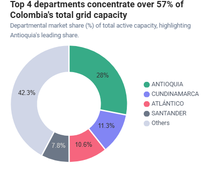
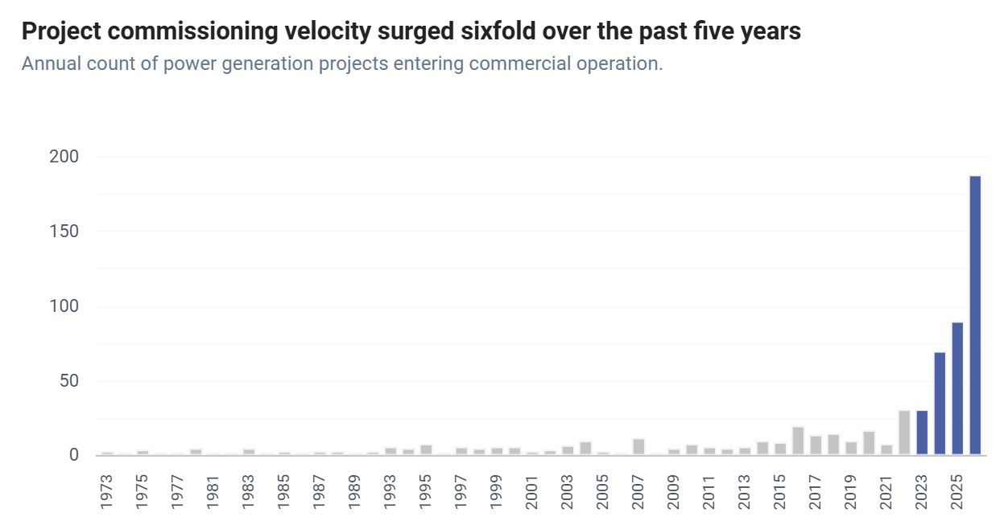
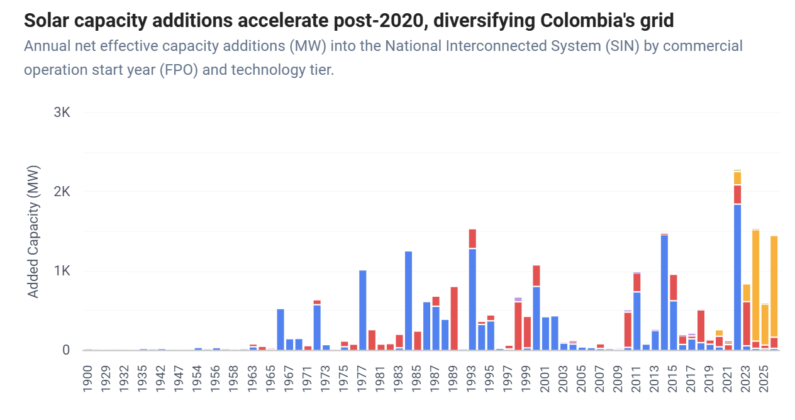
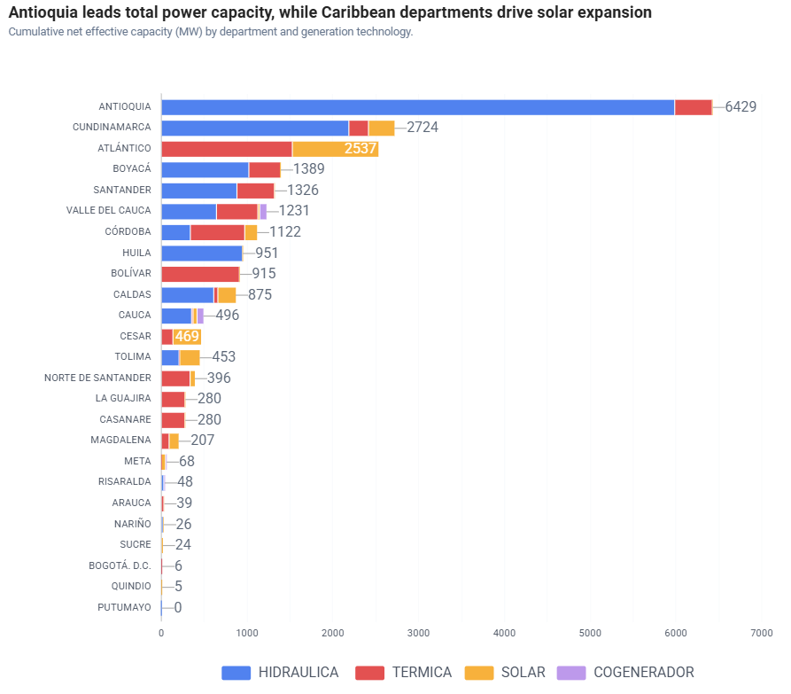
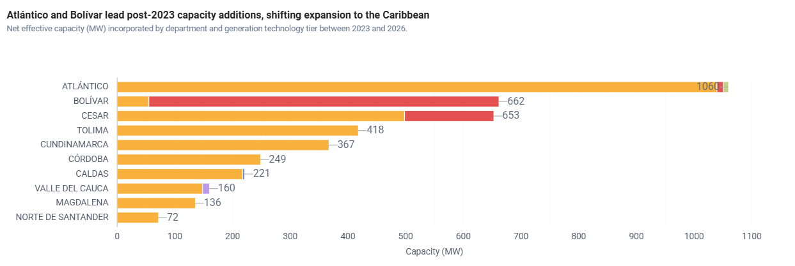
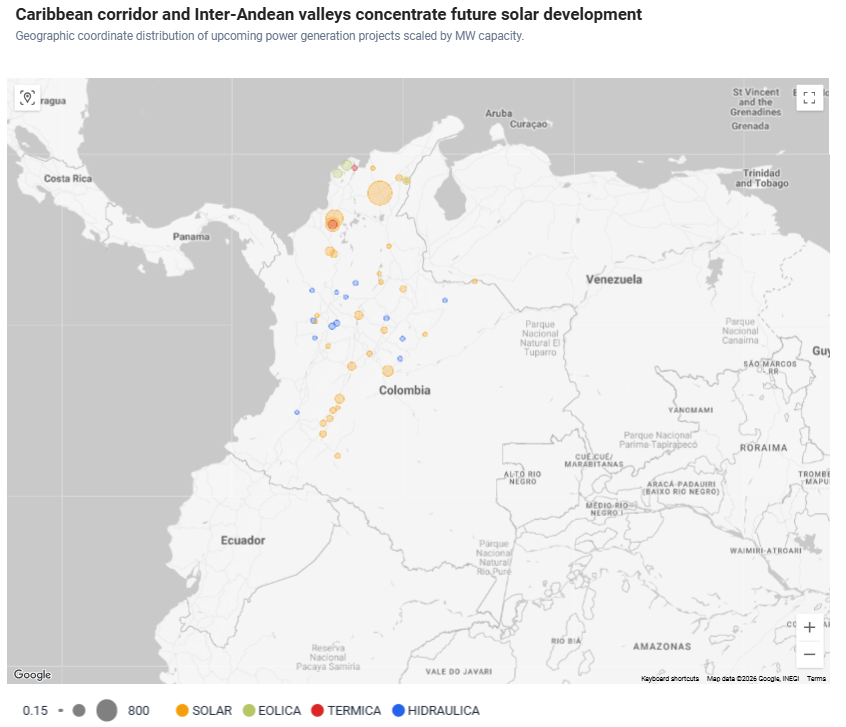
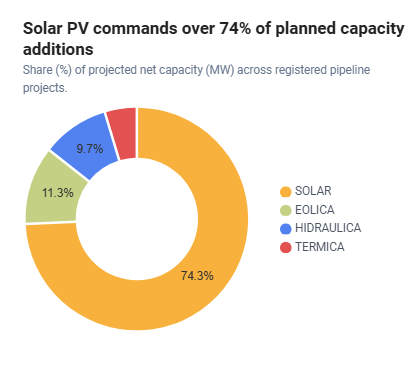
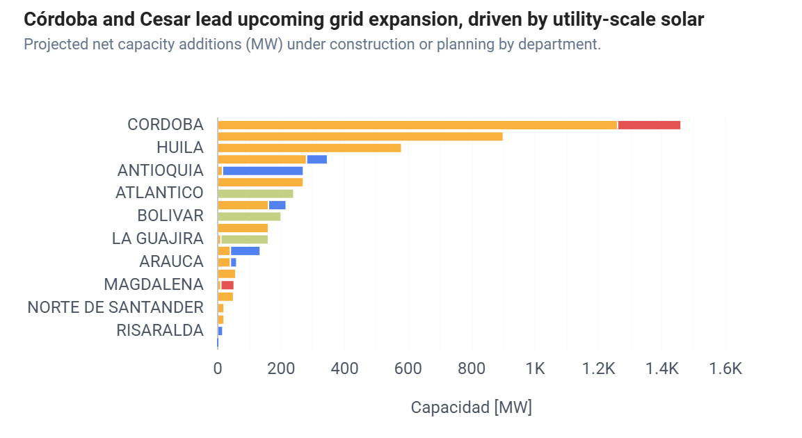

[← Back to Colombia Module](../README.md) | [← Back to LATAM Modules](../../README.md) | [← Back to Root](../../../../README.md)

  

  # Colombian Electricity Generation System Analysis (SIN) | Energy Transition & Non-Conventional Renewable Energy (FNCER)

---

This repository presents a structured exploratory data analysis on the evolution, current installed capacity, and expansion dynamics of the generation fleet across Colombia's National Interconnected System (SIN), covering both operational assets and projects currently under construction.

The analysis utilizes official infrastructure datasets (UPME, XM, and SUI) processed via Python notebooks, ensuring full data traceability and timestamped extraction logs to evaluate the technological and spatial transformations within the national power matrix.

---

## 1. Generation System Analysis in Colombia

The spatial distribution of the SIN reflects a distinct geographic divide: hydroelectric power sustains base-load supply across the Andean inland, whereas solar photovoltaic developments and thermal backup infrastructure form a high-density cluster along the Caribbean Coast. This spatial configuration highlights the onset of a decentralized energy transition expanding beyond the traditional Andean axis.

### Historical Matrix Evolution & Net Effective Capacity

The SIN has surpassed **22,229 MW of Net Effective Capacity**. Historically anchored by hydroelectric power and thermal backup, the fleet now exhibits accelerating technological diversification alongside regional concentration across key departments, we notice that Antioquia, Cundinamarca, Atlantico and Santander concentrate the majority of the generation capacity.

 

  
  

 

- **Decadal Expansion Trends:** For over five decades, Colombia’s power matrix maintained steady growth dominated almost exclusively by large hydroelectric reservoirs and thermal power plants. However, starting this decade, the rapid entry of non-conventional renewable energy (FNCER) technologies has begun shifting the cumulative expansion profile.

- **Annual Commissioning Velocity:** Between 1900 and 2020, asset additions occurred discretely and spaced out over time. Since 2021, the annual volume of operational plant additions has grown exponentially, setting a historic record in absolute commissioning events during the recent period.
  

- **Capacity Additions Volatility:** Despite the high volume of recent additions, net annual capacity additions exhibit significant year-over-year variations. The capacity peak reached in 2022 represents the highest single inflection point for large-scale infrastructure additions in the country's recent history.

- **Technology Shift in Recent Triennium:** While previous expansion cycles (1980–2015) relied on alternating cycles between large-reservoir hydro and gas/coal thermal units, project entries over the recent triennium are heavily dominated by solar photovoltaic technology.
  
- **Geographic Breakdown of Capacity:** Antioquia, Cundinamarca, and Atlántico concentrate nearly 50% of the country’s Net Effective Capacity. Antioquia retains its historical leadership due to the extensive hydroelectric utilization of its river basins.

- **Regional Shifting of New Additions:** Isolating capacity added in recent years reveals a radically different generation geography: Atlántico, Bolívar, and Cesar lead new capacity additions, driven by exceptional solar irradiance levels. Traditionally hydroelectric departments like Antioquia show only marginal contributions to net installed capacity additions over this recent window.

> Full Notebook Execution: [View Generation System Analysis Notebook](./An%C3%A1lisis%20Sistema%20de%20Generaci%C3%B3n%20en%20Colombia.ipynb)

---

## 2. Active Generation Project Pipeline

To address key questions emerging from the previous analysis, this section evaluates whether active project pipelines under construction or registry maintain this strong solar component. To investigate this, we processed UPME’s official active registry report for power generation projects. The dataset used reflects a cutoff date of **August 30, 2026** (note: this file is updated monthly by UPME and requires continuous ingestion).

This file provides valuable structured data regarding project build-out stages, geographic locations, primary energy resources, and technology types.

- **Pipeline Dominance:** The active construction pipeline confirms that solar PV remains the dominant technology, alongside a notable emergence of wind energy projects and run-of-river small hydro installations. The SIN is projected to integrate approximately **2,600 MW of additional capacity by 2029**, marking a historical milestone for annual plant construction volume.

- **Decentralization Trends (2027–2033):** Analyzing regional expansion capacity shows that spatial decentralization persists. During the 2027–2033 horizon, the primary capacity drivers are Córdoba, Cesar, and Huila, which combined account for nearly 50% of incoming generation capacity.

> Full Notebook Execution: [View Project Pipeline Registry Notebook](./Registro%20Activos%20Proyectos%20Generaci%C3%B3n%20-%20Ago%202026.ipynb)

---

> Note on Interactive Visualizations: Some interactive map features (e.g., Folium/Plotly geospatial layers) may not render directly in GitHub's static Markdown preview. To experience full interactive map controls, clone or download the repository and run the Jupyter notebooks locally.
